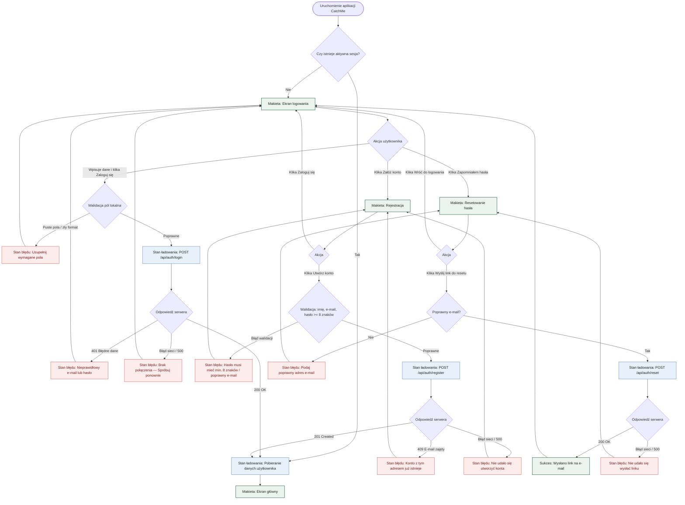
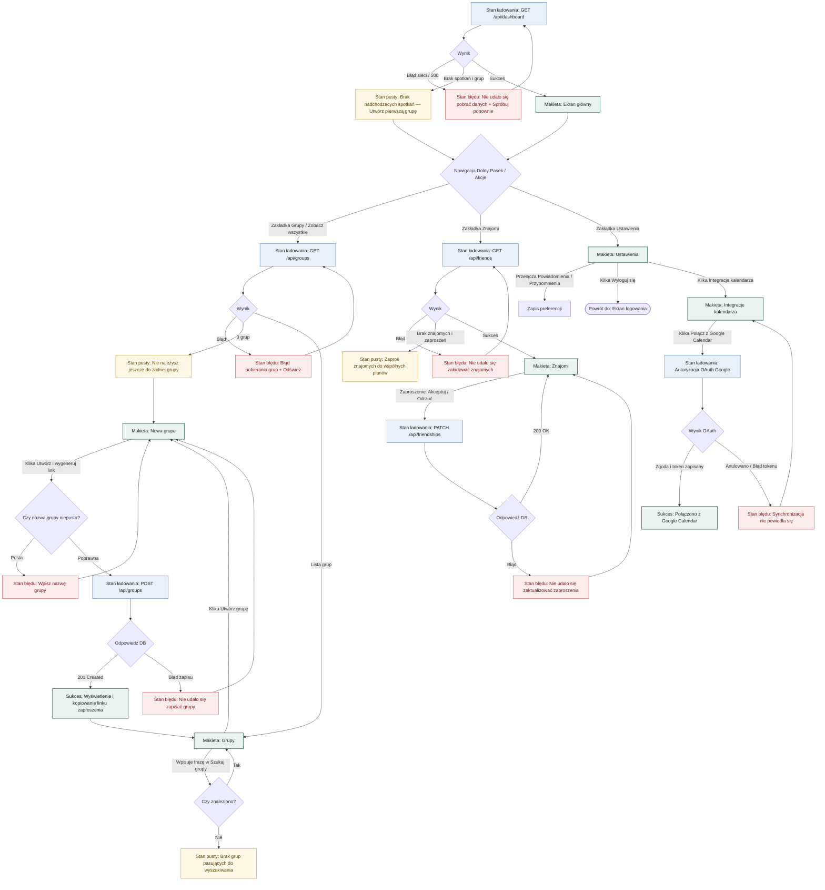
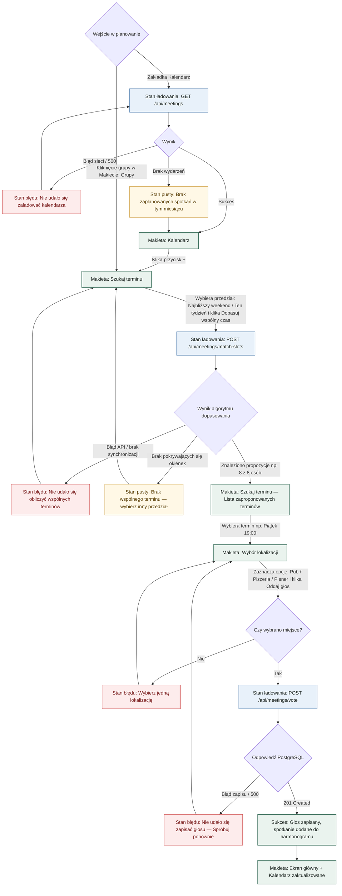

# User Flows i Stany Systemu — Aplikacja CatchMe

Dokument prezentuje pełne schematy ścieżek użytkownika (sukcesy oraz obsługę błędów), zdefiniowane stany systemu (**ładowanie**, **stan pusty**, **stan błędu**) oraz bezpośrednie powiązanie każdego kroku z makietami High-Fidelity.

**Legenda kolorów na diagramach:**
* **Zielony** — ekrany High-Fi i stany sukcesu
* **Niebieski** — stany ładowania (komunikacja z API / PostgreSQL)
* **Żółty** — stany puste (brak danych)
* **Czerwony** — stany błędne i walidacja

---

## Flow 1: Autoryzacja, Rejestracja i Reset Hasła

Obejmuje makiety: **Ekran logowania**, **Rejestracja**, **Resetowanie hasła**, **Ekran główny**.

---

## Flow 2: Ekran główny, Grupy, Znajomi oraz Ustawienia i Integracje

Obejmuje makiety: **Ekran główny**, **Grupy**, **Nowa grupa**, **Znajomi**, **Ustawienia**, **Integracje kalendarza**.

---

## Flow 3: Planowanie spotkania — Kalendarz, Szukaj terminu i Wybór lokalizacji

Obejmuje główny cel biznesowy aplikacji na makietach: **Kalendarz**, **Grupy**, **Szukaj terminu**, **Wybór lokalizacji**, **Ekran główny**.

---

## Zbiorcza macierz stanów systemu dla makiet High-Fi

| Makieta High-Fi | Stan ładowania (Loading) | Stan pusty (Empty) | Stan błędu (Error) | Stan sukcesu (Success) |
| :--- | :--- | :--- | :--- | :--- |
| **Ekran logowania** | Spinner wewnątrz przycisku *Zaloguj się*, zablokowane pola. | Domyślny pusty formularz przy pierwszym uruchomieniu. | Czerwona ramka pola + komunikat (*„Nieprawidłowy e-mail lub hasło”* / *„Brak sieci”*). | Przejście do **Ekranu głównego**. |
| **Rejestracja** | Spinner na przycisku *Utwórz konto*. | Pusty formularz z podpowiedzią *„Użyj co najmniej 8 znaków”*. | Komunikat walidacji (za krótkie hasło, zajęty e-mail). | Utworzenie rekordu w `users` i wejście do aplikacji. |
| **Resetowanie hasła** | Spinner na przycisku *Wyślij link do resetu*. | Puste pole *Adres e-mail*. | Niepoprawny format adresu lub błąd wysyłki z serwera. | Baner potwierdzający wysłanie linku i powrót do logowania. |
| **Ekran główny** | Karty szkieletowe (skeleton cards) w sekcjach *Nadchodzące spotkania* i *Twoje grupy*. | *„Brak nadchodzących spotkań”* + przycisk CTA *„Zaplanuj pierwsze spotkanie”*. | Karta błędu z przyciskiem *„Spróbuj ponownie”* (pull-to-refresh). | Wyświetlenie aktualnej liczby spotkań, kart wydarzeń i skrótów grup. |
| **Grupy** | Lista szkieletowa podczas pobierania `GET /api/groups`. | *„Nie masz jeszcze grup”* lub *„Brak wyników dla frazy...”* po wyszukiwaniu. | Komunikat błędu pobierania z przyciskiem odświeżenia. | Lista aktywnych grup z liczbą członków i najbliższym spotkaniem. |
| **Nowa grupa** | Spinner podczas `POST /api/groups`. | Podgląd placeholderowy linku (*„Podgląd po utworzeniu”*). | Walidacja pustej nazwy grupy lub błąd zapisu w PostgreSQL. | Wygenerowany aktywny link zaproszenia + ikona *checkmark* po skopiowaniu. |
| **Kalendarz** | Wskaźnik ładowania pod siatką dni przy zmianie miesiąca. | Brak kropek pod dniami + *„Brak spotkań w tym okresie”*. | Baner błędu synchronizacji wydarzeń z opcją ponowienia. | Zaznaczony aktywny dzień, kropki wydarzeń i pełna lista spotkań. |
| **Szukaj terminu** | Spinner w przycisku *Dopasuj wspólny czas* + placeholder propozycji. | *„Nie znaleziono wspólnych okienek w wybranym przedziale — zmień zakres”*. | Błąd obliczania dostępności (np. brak połączenia z backendem). | Posortowana lista terminów z etykietą *„Najlepszy termin”* i frekwencją. |
| **Wybór lokalizacji** | Spinner na przycisku *Oddaj głos* przy zapisie do bazy. | Brak wybranej opcji (przycisk *Oddaj głos* nieaktywny). | Komunikat *„Nie udało się zapisać głosu — spróbuj ponownie”*. | Potwierdzenie *„Głos oddany na: ...”* i aktualizacja wydarzenia. |
| **Znajomi** | Skeleton loader dla zaproszeń i listy znajomych. | Ukryta sekcja *Zaproszenia* (gdy 0 nowych); *„Brak znajomych — dodaj pierwszą osobę”*. | Błąd przy akceptacji/odrzuceniu zaproszenia lub brak sieci. | Lista znajomych; po kliknięciu *Akceptuj* płynne przeniesienie osoby na listę. |
| **Ustawienia** | Subtelny wskaźnik przy zapisie zmian preferencji. | Brak danych (nie dotyczy zalogowanego konta). | Błąd zapisu preferencji z cofnięciem stanu przełącznika. | Zapisane ustawienia powiadomień lub poprawne wylogowanie. |
| **Integracje kalendarza** | Ekran pośredni podczas logowania OAuth do Google Calendar. | Status *„Kalendarz nie jest jeszcze połączony”*. | Komunikat *„Nie udało się połączyć z Google Calendar — spróbuj ponownie”*. | Zielony status *„Połączono z Google Calendar”* i opcja odłączenia. |